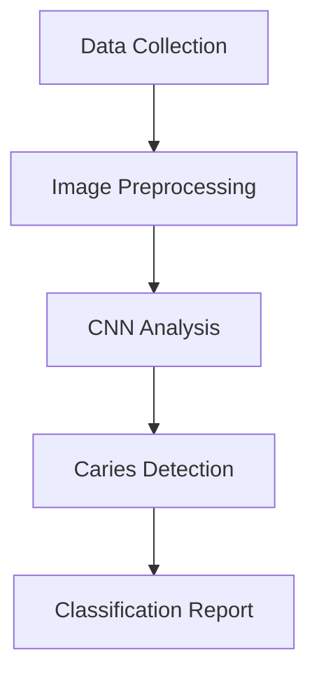

# Intellico User Guide

## 📚 Table of Contents
1. [What is Intellico?](#what-is-intellico)
2. [How It Works](#how-it-works)
3. [Architecture Overview](#architecture-overview)
4. [Getting Started](#getting-started)
5. [Running the Application](#running-the-application)
6. [Using the Application](#using-the-application)
7. [API Endpoints](#api-endpoints)
8. [Troubleshooting](#troubleshooting)

---

## What is Intellico?

**Intellico** is an AI-powered dental research assistant that helps you analyze and understand scientific research papers. It uses advanced natural language processing and machine learning to:

- **📄 Upload & Process PDFs**: Extract text, metadata, and structure from dental research papers
- **📝 Generate Summaries**: Create concise summaries of research papers
- **💬 Answer Questions**: Chat with your papers using RAG (Retrieval-Augmented Generation)
- **🔑 Extract Keywords**: Identify key terms and concepts
- **📊 Create Flowcharts**: Visualize research methodologies and concept flows

**Perfect for**: Dental researchers, students, and clinicians who need to quickly analyze and understand scientific literature.

---

## How It Works

### The AI Pipeline

```
┌─────────────┐
│  Upload PDF │
└──────┬──────┘
       │
       ▼
┌─────────────────────────────┐
│  PDF Processing & Text       │
│  Extraction (PyPDF2)         │
└──────┬──────────────────────┘
       │
       ▼
┌─────────────────────────────┐
│  Metadata Extraction         │
│  (Title, Authors, Abstract)  │
└──────┬──────────────────────┘
       │
       ├──────────────────────────────────────┐
       │                                      │
       ▼                                      ▼
┌──────────────────┐              ┌──────────────────┐
│  Text Chunking   │              │  Keyword         │
│  for RAG         │              │  Extraction      │
└────────┬─────────┘              └──────────────────┘
         │
         ▼
┌─────────────────────────────────────┐
│  Vector Embedding (bge-small-en-v1.5)│
└────────┬────────────────────────────┘
         │
         ▼
┌─────────────────────────────────────┐
│  FAISS Vector Store                 │
│  (Semantic Search)                  │
└────────┬────────────────────────────┘
         │
         ▼
┌─────────────────────────────────────┐
│  Qwen2.5-1.5B Model (Fine-tuned)    │
│  - Summarization                    │
│  - Q&A                              │
│  - Flowchart Generation             │
└─────────────────────────────────────┘
```

### Key Technologies

**AI/ML Models:**
- **Base Model**: Qwen/Qwen2.5-1.5B-Instruct (1.5B parameters)
- **Fine-tuned Adapter**: matteeulhaq/Qwen-1.5B (dental domain specialization)
- **Embedding Model**: BAAI/bge-small-en-v1.5 (semantic search)
- **Guardrails**: Domain-specific content filtering (dentistry only)

**Frameworks:**
- **Backend**: Flask (Python) with CORS support
- **Frontend**: Next.js 16.1.6 with React 19.2.3
- **Database**: MongoDB (paper metadata storage)
- **Vector Search**: FAISS (semantic similarity)

---

## Architecture Overview

### Three-Tier Architecture

```
┌─────────────────────────────────────────────────────────┐
│                    Frontend Layer                       │
│  (Next.js + React + Tailwind CSS + Zustand)            │
│                                                          │
│  • User Interface Components                            │
│  • State Management (localStorage)                      │
│  • API Client (fetch)                                   │
│  • Port: 3000 (dev) / 2600 (Docker)                     │
└────────────────────┬────────────────────────────────────┘
                     │
                     │ HTTP/REST API
                     │
┌────────────────────▼────────────────────────────────────┐
│                   Backend Layer                         │
│              (Flask + Python)                           │
│                                                          │
│  • PDF Processing (PyPDF2, pdfplumber)                  │
│  • ML Model Inference (transformers, torch)             │
│  • RAG Pipeline (FAISS + sentence-transformers)         │
│  • API Endpoints (CORS enabled)                         │
│  • Port: 2750 (dev) / 5000 (Docker internal)           │
└────────────────────┬────────────────────────────────────┘
                     │
                     │
        ┌────────────┼────────────┐
        │            │            │
        ▼            ▼            ▼
  ┌──────────┐ ┌──────────┐ ┌──────────┐
  │ MongoDB  │ │ FAISS    │ │ Hugging │
  │          │ │ Vector   │ │ Face    │
  │ Port:    │ │ Store    │ │ Models  │
  │ 27018    │ │ (Memory) │ │ API     │
  └──────────┘ └──────────┘ └──────────┘
```

### Component Breakdown

#### Frontend Components
```
frontend/intellico/
├── src/
│   ├── app/
│   │   ├── layout.tsx          # Root layout with metadata
│   │   ├── page.tsx            # Main page (Sidebar + Workspace)
│   │   └── globals.css         # Global styles (Tailwind)
│   │
│   ├── components/
│   │   ├── Sidebar.tsx         # Paper history & upload button
│   │   ├── Workspace.tsx       # Main content area
│   │   ├── UploadDropzone.tsx  # PDF upload interface
│   │   ├── PaperHeader.tsx     # Paper metadata display
│   │   ├── SummaryTabs.tsx     # Summary viewer (short/med/long)
│   │   ├── ChatPanel.tsx       # Q&A chat interface
│   │   ├── KeywordPanel.tsx    # Keywords extraction display
│   │   └── FlowchartPanel.tsx  # SVG flowchart viewer
│   │
│   ├── lib/
│   │   ├── api.ts              # API client (fetch wrapper)
│   │   ├── store.ts            # Zustand state management
│   │   └── utils.ts            # Utility functions
│   │
│   └── types/
│       └── index.ts            # TypeScript interfaces
```

#### Backend Components
```
backend/app/
├── main.py                     # Flask app initialization
├── config.py                   # Configuration management
├── controllers.py              # API route handlers
├── paper_analyzer.py           # Core analysis engine
├── pdf_processor.py            # PDF text extraction
├── services.py                 # Business logic layer
│
├── models/                     # Data models & prompts
│   └── prompt_templates.py     # LLM prompt templates
│
├── rag/                        # RAG components
│   ├── retriever.py            # Vector search & retrieval
│   └── embedder.py             # Text embedding
│
├── flowchart/                  # Flowchart generation
│   ├── generator.py            # Mermaid/Graphviz generation
│   └── mermaid_renderer.py     # SVG rendering
│
├── guardrails/                 # Content moderation
│   └── domain_guardrail.py     # Dentistry-only filter
│
└── database/                   # Database utilities
    └── mongodb_client.py       # MongoDB connection
```

---

## Getting Started

### Prerequisites

Before running Intellico, ensure you have:

**Required Software:**
- **Python 3.11+**: For backend ML models and Flask server
- **Node.js 18+**: For Next.js frontend
- **MongoDB 6.0+**: For metadata storage (local or Docker)
- **Docker** (optional): For containerized deployment
- **Git**: For cloning the repository

**Hardware Requirements:**
- **RAM**: 8GB minimum (16GB recommended for ML models)
- **Storage**: 10GB free space (models + papers)
- **GPU**: NVIDIA GPU with CUDA support (optional, speeds up inference)

**Accounts:**
- **HuggingFace Token**: Required for downloading fine-tuned models
  - Get your token at: https://huggingface.co/settings/tokens
  - Already configured in `.env` file

### Initial Setup

#### 1. Clone the Repository
```bash
git clone <repository-url>
cd Intellico-App
```

#### 2. Install Dependencies
```bash
# Install all dependencies (root + frontend)
npm run install:all
```

This installs:
- Root dependencies: `concurrently` (for running both services)
- Frontend dependencies: Next.js, React, Tailwind CSS, etc.
- Backend dependencies: Python packages (via requirements.txt)

#### 3. Configure Environment

**Root `.env` file** (already configured):
```bash
# MongoDB
MONGO_URI=mongodb://localhost:27018/intellico

# Model Configuration
BASE_MODEL_NAME=Qwen/Qwen2.5-1.5B-Instruct
ADAPTER_PATH=matteeulhaq/Qwen-1.5B
USE_HUGGINGFACE_REPO=true
HUGGINGFACE_TOKEN=hf_****************

# RAG Configuration
EMBEDDING_MODEL=BAAI/bge-small-en-v1.5
CHUNK_SIZE=512
CHUNK_OVERLAP=50
TOP_K_CHUNKS=5
```

**Frontend `.env.local`** (auto-created):
```bash
NEXT_PUBLIC_API_BASE_URL=http://localhost:2750
```

#### 4. Start MongoDB

**Option A: Docker (Recommended)**
```bash
docker run -d -p 27018:27017 --name intellico-mongo-dev mongo:6.0
```

**Option B: Local Installation**
```bash
sudo systemctl start mongod  # Linux
brew services start mongodb-community  # macOS
```

---

## Running the Application

### Development Mode (Recommended for Active Development)

This mode runs both frontend and backend with hot-reload for instant updates.

```bash
npm run dev
```

**What happens:**
1. `concurrently` runs both services in parallel
2. **Backend** starts on `http://localhost:2750`
3. **Frontend** starts on `http://localhost:3000`
4. Both services auto-reload on file changes

**Output:**
```
[dev:backend]
Loading embedding model: BAAI/bge-small-en-v1.5
Loading base model: Qwen/Qwen2.5-1.5B-Instruct
Model loaded successfully
Intellico Backend Server
Starting server on http://0.0.0.0:2750

[dev:frontend]
▲ Next.js 16.1.6
- Local:   http://localhost:3000
✓ Starting...
```

**Access the application**: Open http://localhost:3000 in your browser

### Individual Services

Run services separately for debugging or independent development:

```bash
# Backend only (Flask + ML models)
npm run dev:backend
```
- Port: 2750
- Health check: http://localhost:2750/health
- API docs: See [API Endpoints](#api-endpoints) section

```bash
# Frontend only (Next.js)
npm run dev:frontend
```
- Port: 3000
- Auto-reloads on file changes
- Requires backend to be running separately

### Docker Mode (Production-like Environment)

Docker mode runs all services in isolated containers with production configurations.

```bash
# Build and start all containers
npm run docker:up
```

**What happens:**
1. **Builds** Docker images for frontend, backend
2. **Creates** Docker network (`intellico_net`)
3. **Starts** 3 containers:
   - `intellico_frontend` (Next.js on port 2600)
   - `intellico_backend` (Flask on port 2750)
   - `intellico_mongo` (MongoDB on port 27017)

**Access the application**: Open http://localhost:2600 in your browser

#### Docker Commands

```bash
# View logs from all containers
npm run docker:logs

# View logs from specific service
docker-compose logs frontend
docker-compose logs backend
docker-compose logs mongo

# Stop all containers
npm run docker:down

# Restart containers
docker-compose restart

# Rebuild after code changes
docker-compose down
docker-compose up -d --build
```

#### Docker Container Architecture

```
Docker Network: intellico_net (bridge)

┌─────────────────────────────────────┐
│  intellico_frontend                 │
│  • Node:20-alpine                   │
│  • Next.js standalone server        │
│  • Port: 3000 (internal)            │
│  • Exposed: 2600 (host)             │
│  • Env: NEXT_PUBLIC_API_BASE_URL    │
│         =http://backend:2750        │
└──────────┬──────────────────────────┘
           │
           │ HTTP requests
           ▼
┌─────────────────────────────────────┐
│  intellico_backend                  │
│  • Python 3.11                      │
│  • Flask + Gunicorn                 │
│  • Port: 5000 (internal)            │
│  • Exposed: 2750 (host)             │
│  • Volume: ./backend/storage        │
│  • Env: MONGO_URI, ADAPTER_PATH     │
└──────────┬──────────────────────────┘
           │
           │ MongoDB connection
           ▼
┌─────────────────────────────────────┐
│  intellico_mongo                    │
│  • MongoDB 6.0                      │
│  • Port: 27017 (internal)           │
│  • Exposed: 27017 (host)            │
│  • Volume: ./data/mongo             │
└─────────────────────────────────────┘
```

---

## Using the Application

### User Interface Overview

```
┌────────────────────────────────────────────────────┐
│  Intellico                        [New Upload]    │
│  Dental Research Assistant                        │
├───────────────────┬────────────────────────────────┤
│                   │                                │
│  Paper History    │     Main Workspace             │
│                   │                                │
│  • Paper 1        │  ┌──────────────────────────┐ │
│  • Paper 2        │  │  Paper Title             │ │
│  • Paper 3        │  │  Authors • Date          │ │
│                   │  └──────────────────────────┘ │
│  [New Upload]     │                                │
│                   │  [Summary] [Q&A] [Keywords]   │
│                   │           [Flowchart]          │
│                   │                                │
│                   │  ┌──────────────────────────┐ │
│                   │  │                          │ │
│                   │  │    Content Area           │ │
│                   │  │                          │ │
│                   │  │                          │ │
│                   │  └──────────────────────────┘ │
└───────────────────┴────────────────────────────────┘
```

### Step-by-Step Workflow

#### 1. Upload a PDF

**Click "New Upload" button** → **Drag & drop PDF or select file**

**What happens:**
1. Frontend validates file is a PDF
2. Uploads to `/api/upload` endpoint
3. Backend processes PDF:
   - Extracts text using PyPDF2
   - Extracts metadata (title, authors, abstract)
   - Chunks text for RAG (512 tokens per chunk)
   - Generates embeddings using bge-small-en-v1.5
   - Stores in FAISS vector store
   - Saves metadata to MongoDB
4. Returns paper_id and extracted data
5. Frontend adds to sidebar and displays workspace

**Example Response:**
```json
{
  "paper_id": "550e8400-e29b-41d4-a716-446655440000",
  "status": "success",
  "data": {
    "filename": "dental_research.pdf",
    "word_count": 5432,
    "page_count": 8,
    "sections": ["Introduction", "Methods", "Results", "Discussion"],
    "metadata": {
      "title": "Caries Detection Using AI",
      "authors": "Dr. Smith et al.",
      "abstract": "This study explores...",
      "keywords": ["caries", "AI", "detection"]
    }
  }
}
```

#### 2. Generate Summary

**Click "Summary" tab** → **Select length** (Short/Medium/Detailed)

**What happens:**
1. Frontend calls `/api/summarize/<paper_id>`
2. Backend retrieves paper text
3. Sends to Qwen2.5-1.5B model with summarization prompt
4. Model generates ~256 token summary
5. Frontend displays summary (truncated based on selected length)

**Summary Lengths:**
- **Short**: First 2 sentences
- **Medium**: First 4 sentences
- **Detailed**: Full summary
- Labelled "(UI truncated)" when shortened

#### 3. Ask Questions (Q&A)

**Click "Q&A" tab** → **Type question** → **Press Enter**

**What happens:**
1. Frontend sends question to `/api/qa/<paper_id>`
2. Backend performs RAG:
   - Embeds question using bge-small-en-v1.5
   - Searches FAISS for top 5 relevant chunks
   - Combines question + chunks as context
   - Sends to Qwen2.5-1.5B model
3. Model generates answer using retrieved context
4. Frontend displays in chat interface with chunk count

**Example:**
```
User: "What methods were used for caries detection?"

Assistant: The study used convolutional neural networks (CNNs)
to analyze intraoral images. The dataset consisted of
5,000 annotated images...

Sources: ▼ 3 chunks used
```

#### 4. View Keywords

**Click "Keywords" tab**

**What happens:**
1. Frontend displays keywords from upload metadata
2. Keywords extracted during initial processing
3. Search/filter functionality available
4. Note: Relationships visualized in Flowchart tab

#### 5. Generate Flowchart

**Click "Flowchart" tab** → **Click "Generate Flowchart"**

**What happens:**
1. Frontend calls `/api/flowchart/<paper_id>`
2. Backend analyzes paper:
   - Extracts methodology steps
   - Identifies key concepts and relationships
   - Generates Mermaid diagram code
3. Renders Mermaid to SVG using mermaid.ink API
4. Frontend displays SVG with download option

**Example Flowchart:**


---

## API Endpoints

### Base URL
- **Development**: `http://localhost:2750`
- **Docker**: `http://localhost:2750` (host), `http://backend:2750` (internal)

### Endpoints

#### 1. Health Check
```http
GET /health
```

**Response:**
```json
{
  "status": "ok",
  "server": "running",
  "model": {
    "base_model": "Qwen/Qwen2.5-1.5B-Instruct",
    "adapter_path": "matteeulhaq/Qwen-1.5B",
    "use_hf_repo": true,
    "loaded": true
  },
  "mongodb": {
    "uri": "localhost:27018/intellico"
  }
}
```

#### 2. Upload PDF
```http
POST /api/upload
Content-Type: multipart/form-data

file: <pdf-file>
```

**Response:**
```json
{
  "paper_id": "550e8400-e29b-41d4-a716-446655440000",
  "status": "success",
  "data": {
    "filename": "research.pdf",
    "word_count": 5432,
    "page_count": 8,
    "sections": ["Introduction", "Methods", "Results"],
    "metadata": {
      "title": "Research Title",
      "authors": "Author Names",
      "abstract": "Abstract text...",
      "keywords": ["keyword1", "keyword2"],
      "publication_date": "2024-01-01"
    }
  }
}
```

#### 3. Generate Summary
```http
GET /api/summarize/<paper_id>
```

**Response:**
```json
{
  "paper_id": "550e8400-e29b-41d4-a716-446655440000",
  "summary": "This study investigates..."
}
```

#### 4. Question Answering
```http
POST /api/qa/<paper_id>
Content-Type: application/json

{
  "question": "What methods were used?"
}
```

**Response:**
```json
{
  "paper_id": "550e8400-e29b-41d4-a716-446655440000",
  "question": "What methods were used?",
  "answer": "The study used...",
  "num_chunks_used": 5
}
```

#### 5. Generate Flowchart
```http
GET /api/flowchart/<paper_id>
```

**Response:**
- **Content-Type**: `image/svg+xml`
- **Body**: SVG image data

---

## Troubleshooting

### Common Issues & Solutions

#### 1. Frontend Can't Reach Backend

**Symptoms:**
- Uploads fail with "Network Error"
- Health check returns nothing
- Browser console shows CORS errors

**Solutions:**
```bash
# Check backend is running
curl http://localhost:2750/health

# Check frontend environment variable
cat frontend/intellico/.env.local
# Should show: NEXT_PUBLIC_API_BASE_URL=http://localhost:2750

# Verify CORS is enabled (check backend/app/main.py)
# Should have: CORS(app)
```

#### 2. Model Loading Errors

**Symptoms:**
- Backend crashes on startup
- Error: "Model not found"
- Error: "HuggingFace token invalid"

**Solutions:**
```bash
# Check .env file
cat .env | grep -E "ADAPTER_PATH|HUGGINGFACE_TOKEN|USE_HUGGINGFACE_REPO"

# Verify HuggingFace token
# Visit: https://huggingface.co/settings/tokens

# Check model access
# Ensure you have access to: matteeulhaq/Qwen-1.5B
```

#### 3. MongoDB Connection Issues

**Symptoms:**
- Error: "MongoDB not connected"
- Uploads fail to save metadata

**Solutions:**
```bash
# Check MongoDB is running
docker ps | grep mongo
# OR
sudo systemctl status mongod

# Test connection
mongosh mongodb://localhost:27018

# Check MONGO_URI in .env
cat .env | grep MONGO_URI
```

#### 4. Docker Build Failures

**Symptoms:**
- `docker-compose up` fails
- Error: "Build failed"

**Solutions:**
```bash
# Clean rebuild
docker-compose down
docker system prune -af
docker-compose up -d --build

# Check disk space
df -h
# Docker builds need >10GB free space

# View build logs
docker-compose build frontend
docker-compose build backend
```

#### 5. Port Already in Use

**Symptoms:**
- Error: "Port 3000 is already in use"
- Error: "Port 2750 is already in use"

**Solutions:**
```bash
# Find process using port
lsof -i :3000
lsof -i :2750

# Kill process
kill -9 <PID>

# OR use different port
# Frontend: NEXT_PUBLIC_API_BASE_URL=http://localhost:3001
# Backend: FLASK_PORT=2751
```

#### 6. Out of Memory (OOM)

**Symptoms:**
- Backend crashes during processing
- Error: "CUDA out of memory"
- System becomes slow

**Solutions:**
```bash
# Reduce chunk size in .env
CHUNK_SIZE=256  # Default: 512

# Use CPU instead of GPU
# Set in backend code or remove CUDA_VISIBLE_DEVICES

# Close other applications
# Free up RAM

# Restart services
docker-compose restart
```

### Debug Mode

Enable verbose logging for debugging:

```bash
# Backend debug mode
export FLASK_DEBUG=true
npm run dev:backend

# Frontend debug mode
cd frontend/intellico
npm run dev -- --debug

# Docker logs
docker-compose logs -f backend
docker-compose logs -f frontend
```

### Health Check Script

```bash
#!/bin/bash
# health-check.sh

echo "Checking Intellico services..."

# Check backend
echo -n "Backend: "
if curl -s http://localhost:2750/health > /dev/null; then
    echo "✓ Running"
else
    echo "✗ Down"
fi

# Check frontend
echo -n "Frontend: "
if curl -s http://localhost:3000 > /dev/null; then
    echo "✓ Running"
else
    echo "✗ Down"
fi

# Check MongoDB
echo -n "MongoDB: "
if docker ps | grep intellico-mongo-dev > /dev/null; then
    echo "✓ Running"
else
    echo "✗ Down"
fi
```

---

## Advanced Usage

### Custom Model Configuration

To use a different fine-tuned model:

```bash
# Edit .env file
nano .env

# Update these lines:
ADAPTER_PATH=your-username/your-model-name
USE_HUGGINGFACE_REPO=true
HUGGINGFACE_TOKEN=your_token_here
```

### Adjusting RAG Parameters

Optimize retrieval for your use case:

```bash
# In .env file

# More chunks = more context, slower response
TOP_K_CHUNKS=10  # Default: 5

# Smaller chunks = more precise, less context
CHUNK_SIZE=256  # Default: 512

# More overlap = better context continuity
CHUNK_OVERLAP=100  # Default: 50
```

### Production Deployment

For production deployment, consider:

1. **Use Production WSGI Server**
   ```bash
   # Backend already uses Gunicorn in Docker
   # For local production:
   gunicorn -w 4 -b 0.0.0.0:2750 app.main:app
   ```

2. **Enable HTTPS**
   ```nginx
   # nginx.conf example
   server {
       listen 443 ssl;
       server_name intellico.example.com;

       ssl_certificate /path/to/cert.pem;
       ssl_certificate_key /path/to/key.pem;

       location / {
           proxy_pass http://localhost:3000;
       }

       location /api/ {
           proxy_pass http://localhost:2750;
       }
   }
   ```

3. **Restrict CORS**
   ```python
   # In backend/app/main.py
   CORS(app, origins=["https://intellico.example.com"])
   ```

4. **Add Authentication**
   ```python
   # Add API key authentication to endpoints
   # Or integrate with OAuth2/JWT
   ```

---

## Summary

**Intellico** is a powerful AI-powered dental research assistant that combines:

- **Advanced NLP**: Qwen2.5-1.5B model fine-tuned for dentistry
- **RAG Pipeline**: Semantic search with FAISS + bge-small-en-v1.5
- **Modern Frontend**: Next.js 16 with React 19 and Tailwind CSS
- **Robust Backend**: Flask with MongoDB and ML model integration
- **Easy Deployment**: Docker support for production-ready setup

**Quick Start:**
```bash
npm run install:all
npm run dev
# Open http://localhost:3000
```

**For issues or questions:**
- Check the [Troubleshooting](#troubleshooting) section
- Review logs: `docker-compose logs -f`
- Verify health: `curl http://localhost:2750/health`

Enjoy analyzing dental research papers with AI! 🦷🤖
